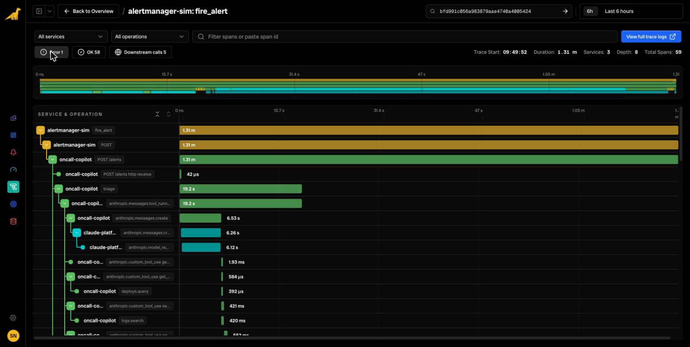
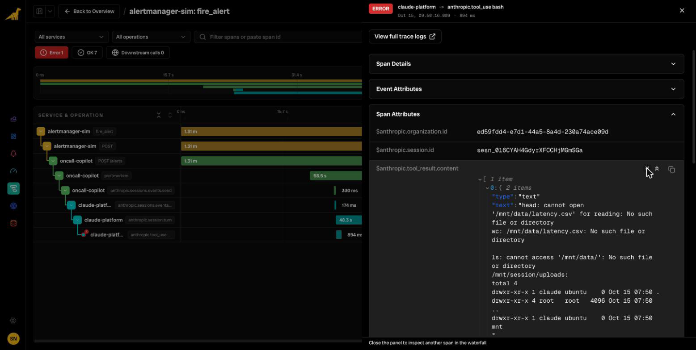

# On-call Copilot: a Claude Platform + OpenTelemetry lab

[](https://github.com/bronto-community/claude-otel-lab/actions/workflows/ci.yml) [](LICENSE)

A small but realistic app for exploring the Claude Platform's [OpenTelemetry export](https://platform.claude.com/docs/en/manage-claude/opentelemetry). It works with any OTLP backend and has one-variable setup for [Bronto](https://bronto.io).

An alert fires. The **On-call Copilot**, a FastAPI service, triages it with Claude and four tools over a (fake) production world: deploys, logs, latency and runbooks. It can then hand the incident to a **Claude Managed Agent** that analyses the latency data in a sandbox and writes the postmortem.

Each alert produces **one distributed trace** that runs from the alerting system, through your service and the Claude SDK, into the Claude API and down to each model run and tool call:

```text
fire_alert                                        alertmanager-sim
└─ POST /alerts                                   oncall-copilot      FastAPI
   ├─ triage                                      oncall-copilot      your code
   │  └─ anthropic.messages.tool_runner           oncall-copilot      Claude SDK
   │     ├─ anthropic.messages.create   CLIENT    oncall-copilot      Claude SDK
   │     │  └─ anthropic.messages.create SERVER   claude-platform     Claude API
   │     │     └─ anthropic.model_request         claude-platform     Claude API
   │     ├─ anthropic.custom_tool_use search_logs oncall-copilot      Claude SDK
   │     │  └─ logs.search                        oncall-copilot      your code
   │     ├─ anthropic.custom_tool_use get_latency oncall-copilot      ERROR in chaos mode
   │     └─ …
   └─ postmortem                                  oncall-copilot      your code
      ├─ anthropic.files.upload                   oncall-copilot      Claude SDK
      ├─ anthropic.sessions.events.send  CLIENT   oncall-copilot      Claude SDK
      │  └─ anthropic.sessions.events.send SERVER claude-platform     Claude API
      │     └─ anthropic.session.turn             claude-platform     Managed Agents
      │        ├─ anthropic.tool_use bash         claude-platform     ran in Anthropic's sandbox
      │        ├─ anthropic.model_request         claude-platform
      │        └─ anthropic.tool_use write        claude-platform
      ├─ anthropic.custom_tool_use get_incident_timeline              your tool, called by the agent
      └─ …
```



## How the telemetry flows

There are two independent span sources, and the lab uses both:

| | **SDK tracing** | **API tracing** |
| --- | --- | --- |
| Emitted by | The Claude SDK in your process | Anthropic's servers |
| Sent with | *your* OpenTelemetry exporter | A *destination* set up in the Claude Console |
| Shows | Requests, the tool runner, your tools, file uploads | Model runs, server tools, Managed Agents turns, sandbox tools |
| Needs | Nothing beyond OTel setup | Org admin; a public HTTPS OTLP/HTTP endpoint |

The SDK sends a W3C `traceparent` header with each request, and the API attaches its spans to that trace, so both sources show up in one trace.

## Quickstart

You need:
- a [Claude API key](https://platform.claude.com/settings/keys)
- somewhere to send traces: a [Bronto](https://bronto.io) account (there's a 14-day free trial), any other OTLP backend, or nothing, in which case spans are printed to the console
- Python 3.10+ (or Docker, see [below](#run-with-docker))

```bash
git clone https://github.com/bronto-community/claude-otel-lab && cd claude-otel-lab
make setup        # creates .venv and .env; then put your keys in .env
make demo         # starts the copilot, fires one alert, prints the trace ID
```

| Command | What it does | Cost |
| --- | --- | --- |
| `make demo` | One alert: Claude triages it with four tools | A few cents |
| `make chaos` | Same, but the metrics backend times out | A few cents |
| `make postmortem` | Triage, then a Managed Agent writes the postmortem to `postmortems/` | About $0.25, hard cap $0.50 |
| `make server` + `make alert` | Run the copilot and fire alerts yourself | |
| `make test` | Offline tests, no API key needed | Free |

`make demo` only sends **SDK spans** (your side). To also get the **API spans** (model runs, server tools, agent turns), add a destination in the Claude Console once.

### Send API spans to your backend

In the Claude Console, open [Settings → OpenTelemetry](https://platform.claude.com/settings/telemetry-destinations) → **Add destination**. You need the org admin role.

| Field | Bronto | Any other backend |
| --- | --- | --- |
| Provider | Custom | Your platform, or Custom |
| OTLP endpoint URL | `https://ingestion.eu.bronto.io` (or `.us.`) | Its OTLP/HTTP **base** URL, without `/v1/traces` |
| Request headers | `x-bronto-api-key` = your key | Its auth header |
| Content mode | Full content (to see prompts and responses) | |

Click **Test** in the destination's menu and check that an `anthropic.test` span arrives. With an Admin API key, `scripts/add_destination.sh` does the same from the command line.

### Find the trace

Every run prints a `trace_id`. In Bronto, open **Tracing**, paste the ID into the **Trace ID** box, and you'll get the whole waterfall. Use the **Error** toggle to jump to failed spans. If your Bronto API key can read data, `python scripts/bronto_trace.py --trace <trace_id>` prints the trace as a tree in the terminal.

### Run with Docker

```bash
cp .env.example .env                        # add your keys
docker compose up -d copilot
docker compose run --rm alert               # or: --postmortem, --chaos
```

## Things to try

| Experiment | How | What to look for |
| --- | --- | --- |
| **A failing tool** | `make chaos`, or `fire_alert --chaos` (`LAB_CHAOS=1` turns it on for every alert) | `get_latency` and `metrics.query` are `ERROR`. Claude retries, then its answer says what it couldn't verify. The trace shows why the answer is hedged. |
| **Prompts and responses** | Toggle `ANTHROPIC_OPEN_TELEMETRY_TRACES_CONTENT_MODE` and the destination's content mode | `gen_ai.input.messages`, `gen_ai.output.messages`, `gen_ai.system_instructions`, tool arguments and results |
| **One conversation** | Every triage uses the alert ID as `conversation_id` | Group by `gen_ai.conversation.id` to see all requests of one triage |
| **A whole agent session** | Run with `--postmortem` | Group by `anthropic.session.id`. Each `anthropic.session.turn` has `stop_reason` (`requires_action` when it waits for your tool), and sandbox tool spans show the commands the agent ran. |
| **Token spend** | Sum `gen_ai.usage.input_tokens` / `output_tokens` over `anthropic.model_request` spans, grouped by `gen_ai.request.model` | Sum one level only: the CLIENT, SERVER and `model_request` spans repeat the same usage. |
| **Tool latency** | Sort the `anthropic.custom_tool_use *` spans by duration | Compare your tools' time with model time in the same trace. |
| **Correlated logs** | Search the app's logs for the `trace_id` | Tool and triage logs carry the trace and span IDs. |
| **Another model** | `LAB_MODEL=claude-sonnet-5-5` or `claude-haiku-5-5` | `gen_ai.request.model`, latency and tokens per model |

### A bug that tracing found

The first version of `postmortem.py` mounted the CSV at `mount_path="/mnt/data/latency.csv"` and told the agent to read it from there. The postmortem still came out fine, but the trace told a different story. The first `anthropic.tool_use bash` span was `ERROR` (`No such file or directory`), and the next one was a 12-second `find /` looking for the file. Managed Agents roots `mount_path` under `/mnt/session/uploads/`. Without the trace, that wasted time and those wasted tokens would have gone unnoticed.



## Use any OTLP backend

The app is configured only through the standard OpenTelemetry environment variables. `oncall/telemetry.py` just fills them in for you when `BRONTO_API_KEY` is set:

```bash
OTEL_EXPORTER_OTLP_ENDPOINT=https://otlp.example.com      # base URL; the SDK appends /v1/traces and /v1/logs
OTEL_EXPORTER_OTLP_HEADERS=authorization=Bearer <token>
```

If nothing is configured, spans are printed to the console.

The API spans need the Console destination, which has stricter requirements than your app's exporter: OTLP/HTTP with protobuf, a public HTTPS hostname on port 443, and a reply within 5 seconds. A backend on `localhost` only receives the SDK side of the trace. To get both sides into a local backend, put a Collector with a public HTTPS endpoint in front of it.

## Cost and cleanup

Defaults: `claude-opus-5-5` at `effort: low`. A triage is about 5k input and 0.8k output tokens across three requests. Each postmortem session has a hard budget (`LAB_SESSION_BUDGET_CENTS`, default 50 cents), and the session pauses when it reaches it.

The agent and environment are created once and stored in `.lab-state.json`; delete the file to recreate them. Sessions are archived after each run. `make clean` removes the virtualenv and local state.

## Layout

```text
oncall/
  telemetry.py    OTel traces and logs over OTLP/HTTP (standard OTEL_* vars, Bronto shortcut)
  app.py          FastAPI alert webhook
  fire_alert.py   Simulated alerting system (propagates traceparent)
  triage.py       Messages API + tool runner
  tools.py        Client-side tools, with their own spans and logs; LAB_CHAOS
  postmortem.py   Managed Agents session: file upload, sandbox, custom tool, budget
  ops_data.py     The fake production world
scripts/
  demo.sh              Start the copilot, fire one alert, stop
  add_destination.sh   Create a Console destination with the Admin API
  bronto_trace.py      Print a trace from Bronto as a tree
tests/                 Offline tests (make test)
```

## License

Apache-2.0. See [LICENSE](LICENSE).

Pinned to `anthropic==1.14.0` and `opentelemetry-sdk==1.45.1`. Claude's OpenTelemetry support is in beta, and span names and attributes can change between SDK versions.
